# Rapport de captures d'écran : virtualisation imbriquée

**Complément du rapport de TP « Chapitre 1 : Manipuler un hyperviseur de type 2 »**

Réalisé par : Romaissa Meliani | Captures prises le 6 novembre 2026, entre 20h00 et 20h21

## Sommaire

1. [Introduction](#1-introduction)
2. [Hôte VMware Workstation](#2-hôte-vmware-workstation)
3. [VM1 : Proxmox pve1](#3-vm1--proxmox-pve1)
4. [VM11 : Ubuntu sous Cockpit](#4-vm11--ubuntu-sous-cockpit)
5. [VM12 : Ubuntu sous Cockpit](#5-vm12--ubuntu-sous-cockpit)
6. [VM2 : Ubuntu + KVM sous Cockpit](#6-vm2--ubuntu--kvm-sous-cockpit)
7. [VM21 : Proxmox pve21](#7-vm21--proxmox-pve21)
8. [VM22 : Proxmox pve22](#8-vm22--proxmox-pve22)
9. [Observations](#9-observations)
10. [Conclusion](#10-conclusion)

## 1. Introduction

Ce document présente, de façon brève, les 26 captures d'écran qui prouvent le bon fonctionnement de l'architecture décrite dans le rapport principal : VMware Workstation héberge VM1 (Proxmox VE 7.4) et VM2 (Ubuntu 26.10 + KVM), qui hébergent à leur tour VM11, VM12, VM21 et VM22.

Les captures viennent de deux postes : le **PC Windows** (navigateur et VMware Workstation) et le **téléphone**, connecté au même point d'accès Wi-Fi (réseau 10.84.119.0/24). Les captures du téléphone prouvent que les machines sont joignables depuis un autre appareil, comme l'énoncé le demande.

| Machine | Rôle | Adresse | Interface | Figures |
|---|---|---|---|---|
| VM1 (pve1) | Proxmox VE 7.4 | 10.84.119.201 | Web, port 8006 | 1, 3 à 7 |
| VM11 | Ubuntu Server, invité de VM1 | 10.84.119.242 | Cockpit, port 9090 | 8 à 11 |
| VM12 | Ubuntu Server, invité de VM1 | 10.84.119.63 | Cockpit, port 9090 | 12 à 15 |
| VM2 | Ubuntu + KVM | 10.84.119.81 | Cockpit, port 9090 | 2, 16 à 19 |
| VM21 (pve21) | Proxmox VE 7.4, invité de VM2 | 10.84.119.202 | Web, port 8006 | 20 à 23 |
| VM22 (pve22) | Proxmox VE 7.4, invité de VM2 | 10.84.119.203 | Web, port 8006 | 24 à 26 |

Le navigateur affiche « Non sécurisé » sur toutes les pages : les certificats sont auto-signés et la connexion se fait en HTTPS sans autorité de certification.

## 2. Hôte VMware Workstation
**Figure 1.** La console de VM1 affiche l'écran d'accueil de Proxmox VE (nœud `pve1`, noyau 5.15.102-1-pve) avec l'adresse d'administration `https://10.84.119.201:8006/`. La session `root` est ouverte. La bibliothèque VMware contient aussi VM2-Ubuntu, vCSA et une VM Kali.

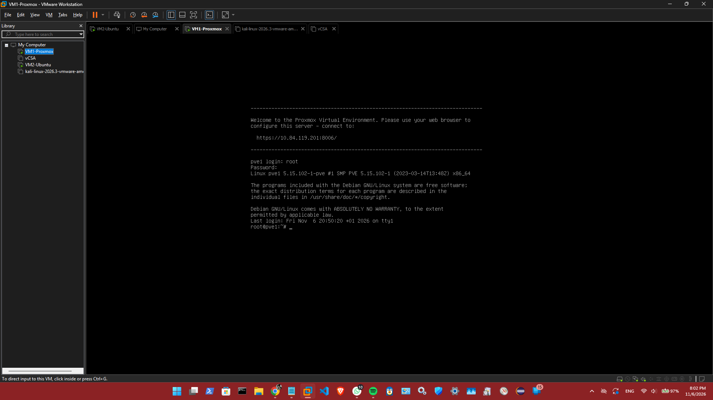

<em>Figure 1 : Console de VM1 dans VMware Workstation</em>

**Figure 2.** VM2 est démarrée et affiche le bureau Xfce (Xubuntu) installé pour utiliser virt-manager.

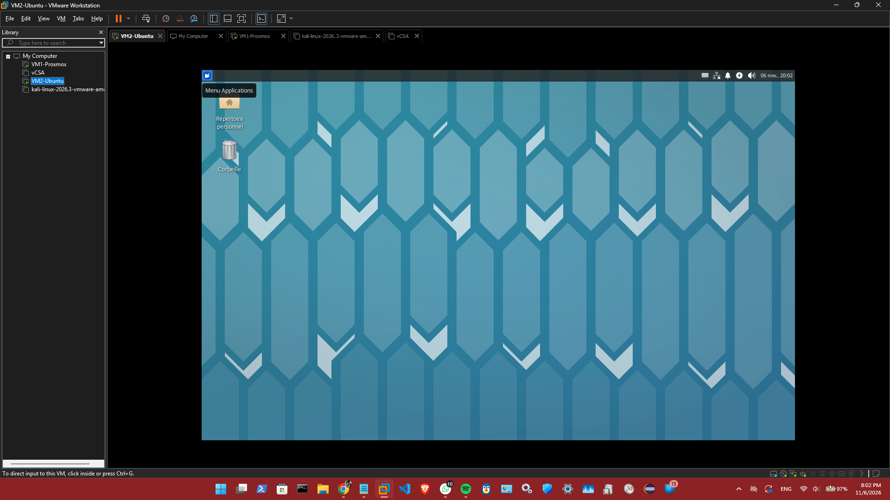

<em>Figure 2 : Bureau Xfce de VM2 dans VMware Workstation</em>

## 3. VM1 : Proxmox pve1

**Figure 3.** L'interface Proxmox VE 7.4-3 de pve1 liste les deux invités de niveau 2 : VM 100 (VM11) et VM 101 (VM12), tous deux démarrés (uptime de quelques secondes). Les pics de CPU (environ 95 %) correspondent au démarrage. Le stockage `local` est utilisé à 50,3 % et `local-lvm` à 98,7 %.

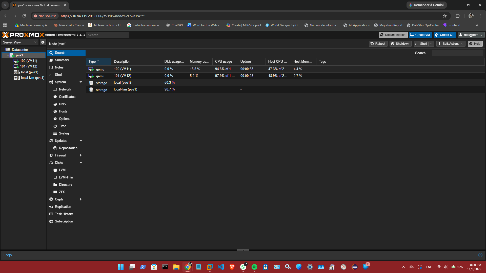

<em>Figure 3 : Vue du nœud pve1 dans Proxmox</em>

**Figure 4.** VM11 : 1 vCPU, 1 Gio de RAM, disque de 10 Gio, état *running*. Le graphique mémoire montre la montée en charge au démarrage. Aucun agent invité n'est configuré, donc pas d'adresse IP affichée.

<em>Figure 4 : Résumé de la VM 100 (VM11)</em>

**Figure 5.** VM12 : 1 vCPU, 2 Gio de RAM, disque de 10 Gio, état *running*, avec le même profil de démarrage que VM11.

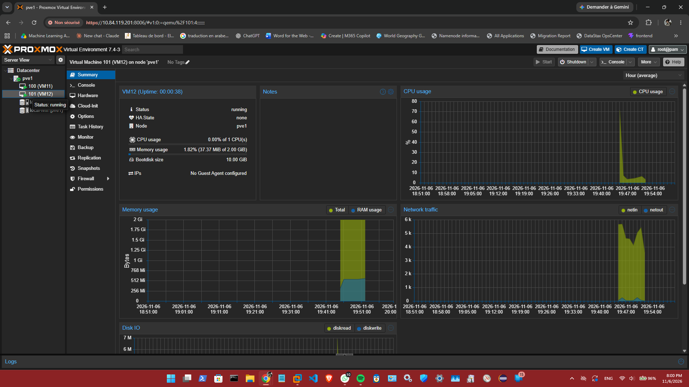

<em>Figure 5 : Résumé de la VM 101 (VM12)</em>

**Figure 6.** Page de connexion Proxmox sur `10.84.119.201:8006`, ouverte depuis le téléphone (realm : Linux PAM).

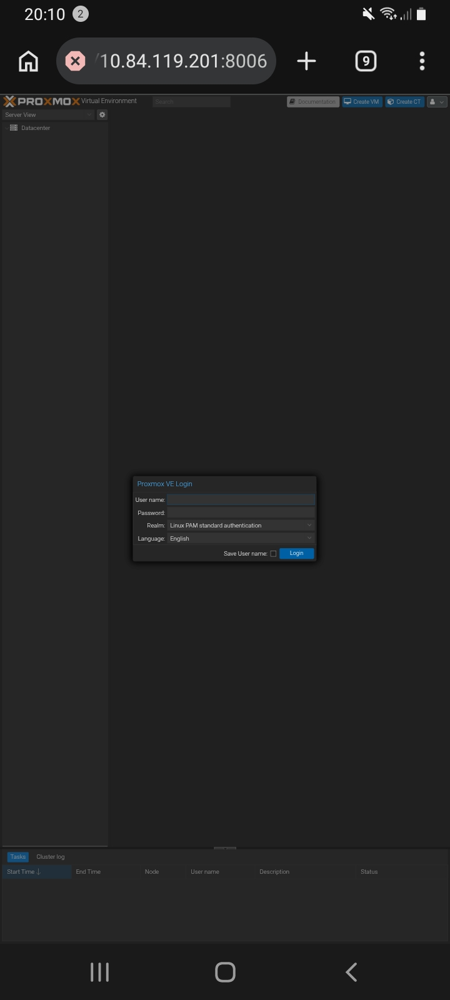

<em>Figure 6 : Connexion à pve1 depuis le téléphone</em>

**Figure 7.** Après connexion en `root@pam`, le téléphone affiche VM100 et VM101 et l'historique des tâches de démarrage (*Start all VMs and Containers*, *VM 100/101 – Start*, statut OK).

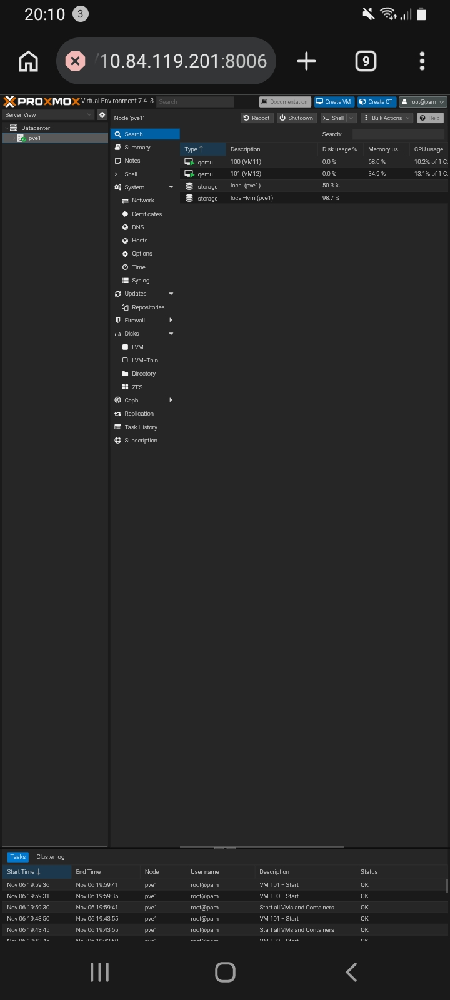

<em>Figure 7 : Nœud pve1 depuis le téléphone</em>

## 4. VM11 : Ubuntu sous Cockpit

**Figure 8.** Cockpit (port 9090) indique `vm11` sous Ubuntu 26.10, modèle *QEMU Standard PC (i440FX + PIIX)*, 1 CPU et 950 Mio de RAM. Le système est à jour et la console est en mode accès limité.

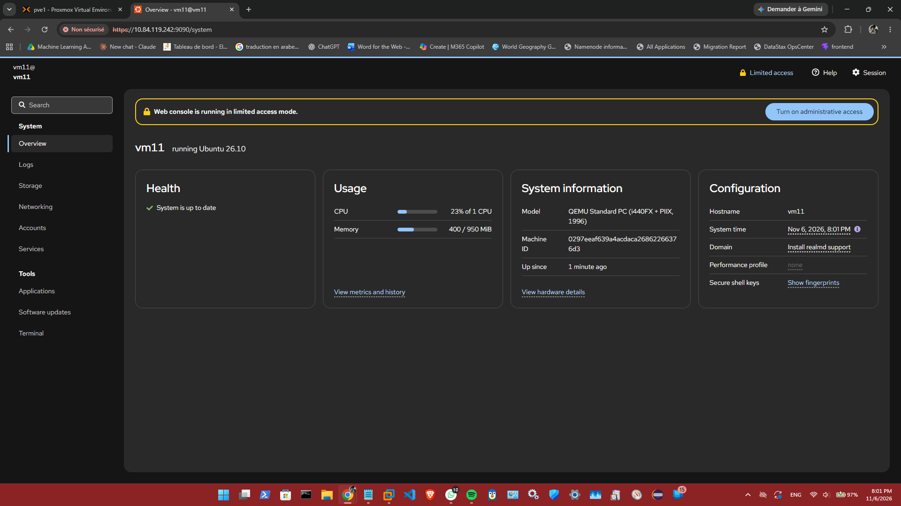

<em>Figure 8 : Cockpit de VM11, vue d'ensemble</em>

**Figure 9.** Le journal ne contient que des avertissements : `virt/tdx: TDX not supported by the host platform` (noyau, normal en virtualisation imbriquée) et des délais dépassés de `chronyd` lors de la synchronisation NTS-KE avec les serveurs `ntp.ubuntu.com` (port 4460). Un redémarrage figure entre les deux séries.

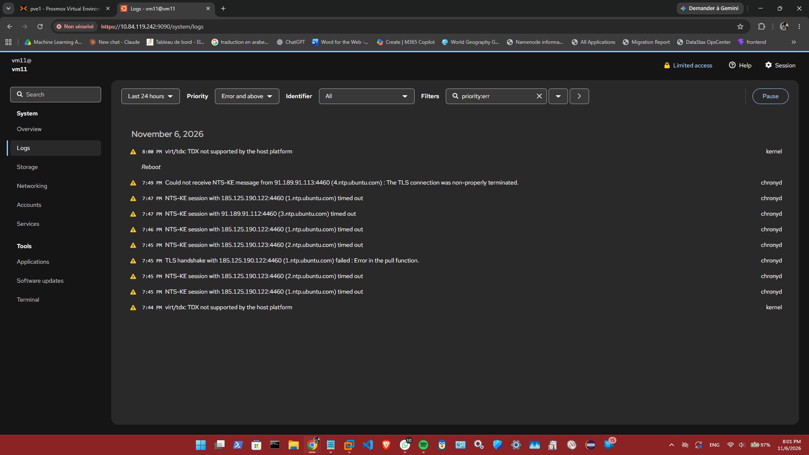

<em>Figure 9 : Journal de VM11 (priorité « erreur et plus »)</em>

**Figure 10.** Page de connexion en français sur `10.84.119.242:9090`, serveur `vm11`.

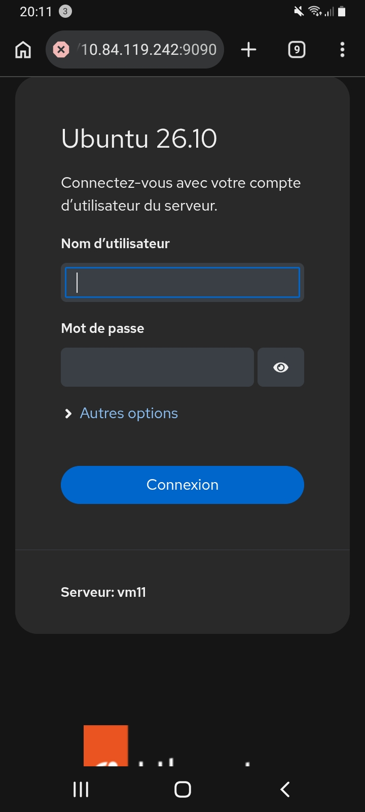

<em>Figure 10 : Connexion Cockpit de VM11 depuis le téléphone</em>

**Figure 11.** Vue d'ensemble de vm11 sur le téléphone : système à jour, CPU à 37 % de 1 CPU, mémoire 430 / 950 Mio.

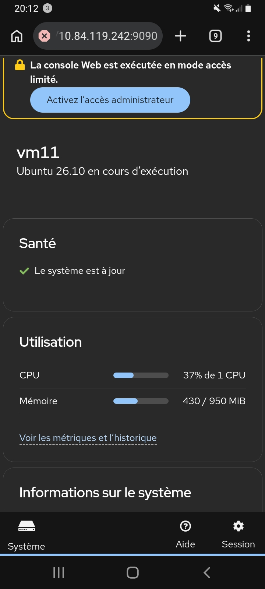

<em>Figure 11 : Cockpit de VM11 sur le téléphone</em>

## 5. VM12 : Ubuntu sous Cockpit

**Figure 12.** `vm12` sous Ubuntu 26.10 (QEMU Standard PC), 1 CPU et 1,6 Gio de RAM, démarrée depuis 2 minutes. Cockpit signale des mises à jour de correction de bogues disponibles.

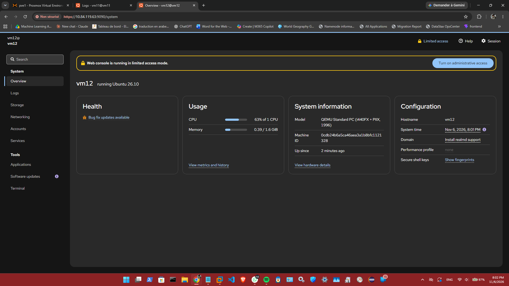

<em>Figure 12 : Cockpit de VM12, vue d'ensemble</em>

**Figure 13.** Seul l'avertissement `TDX not supported by the host platform` apparaît avant et après le redémarrage. Aucune erreur réelle.

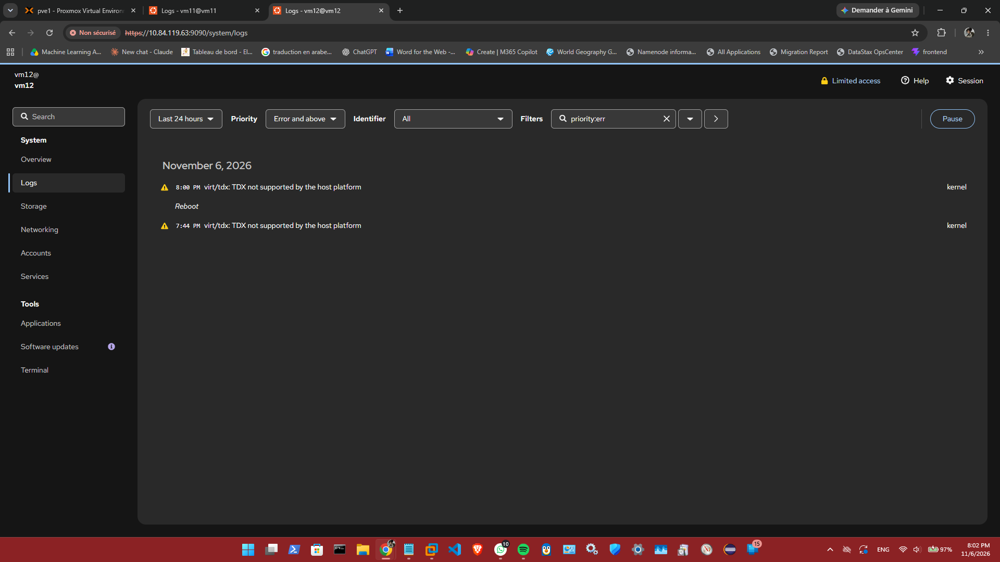

<em>Figure 13 : Journal de VM12 (priorité « erreur et plus »)</em>

**Figure 14.** Page de connexion sur `10.84.119.63:9090`, serveur `vm12`.

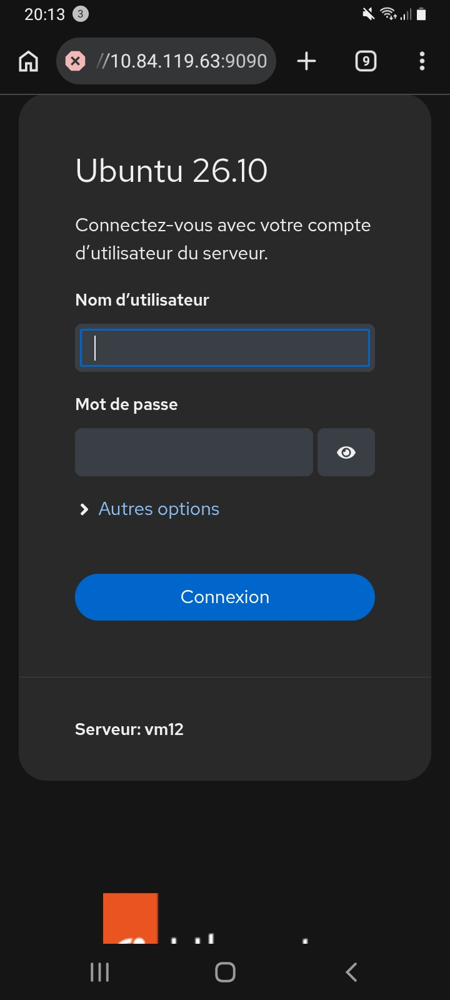

<em>Figure 14 : Connexion Cockpit de VM12 depuis le téléphone</em>

**Figure 15.** Vue d'ensemble de vm12 : mises à jour disponibles, CPU à 56 %, mémoire 0,42 / 1,6 Gio.

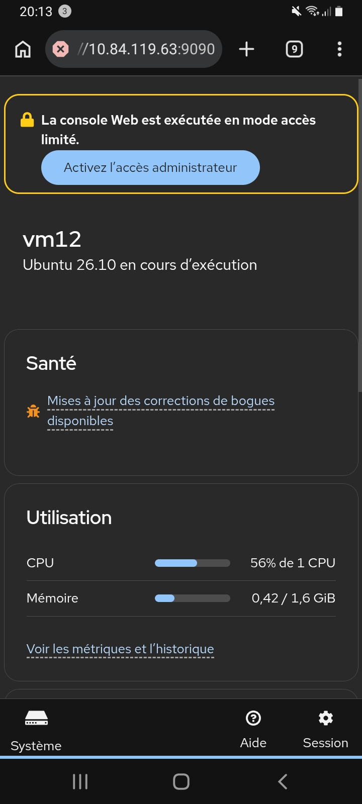

<em>Figure 15 : Cockpit de VM12 sur le téléphone</em>

## 6. VM2 : Ubuntu + KVM sous Cockpit

**Figure 16.** Page de connexion sur `https://10.84.119.81:9090`, serveur `vm2`.

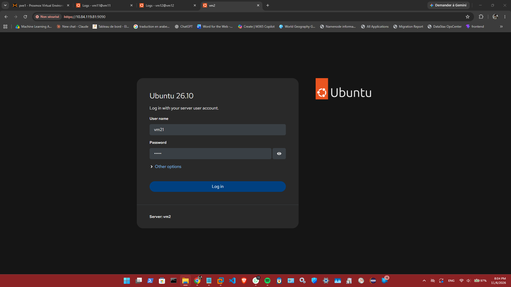

<em>Figure 16 : Connexion Cockpit de VM2 depuis Windows</em>

**Figure 17.** `vm2` sous Ubuntu 26.10 sur *VMware Virtual Platform* : 2 CPU, 5,2 Gio de RAM (4,1 Gio utilisés), système à jour. Le menu **Virtual machines** (module `cockpit-machines`) permet de gérer vm21 et vm22.

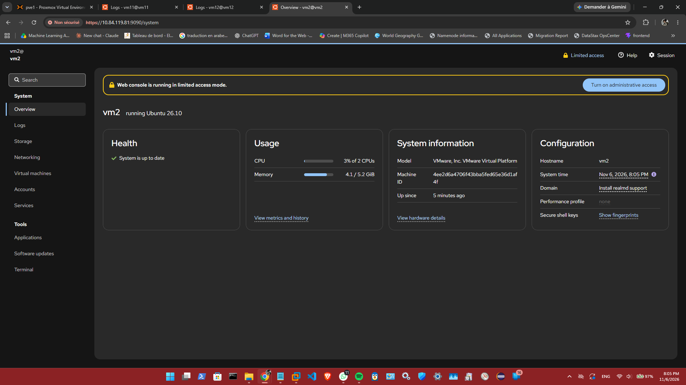

<em>Figure 17 : Cockpit de VM2, vue d'ensemble</em>

**Figure 18.** Saisie de l'utilisateur `vm2` sur `10.84.119.81:9090`.

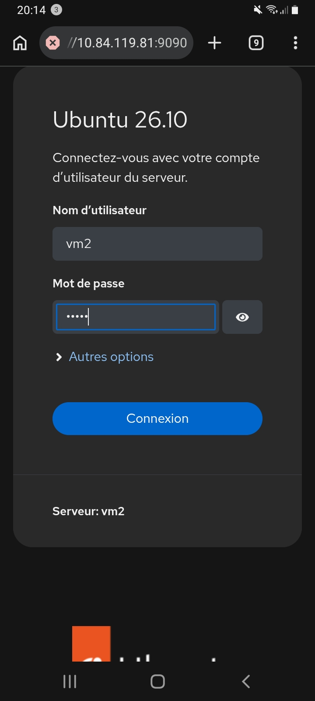

<em>Figure 18 : Connexion Cockpit de VM2 depuis le téléphone</em>

**Figure 19.** Vue d'ensemble de vm2 sur le téléphone : CPU à 5 % de 2 CPU, mémoire 4,2 / 5,2 Gio.

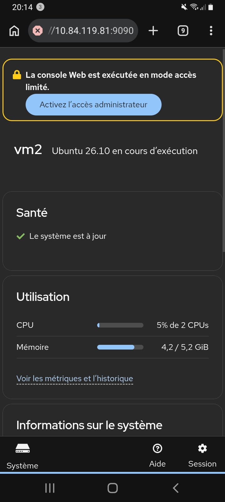

<em>Figure 19 : Cockpit de VM2 sur le téléphone</em>

## 7. VM21 : Proxmox pve21

**Figure 20.** pve21, invité de VM2, fonctionne avec le même Proxmox VE 7.4-3. Stockage `local` à 30,2 % et `local-lvm` à 0 %. Les tâches *Start all VMs and Containers* du 6 novembre à 20:01:55 sont en statut OK.

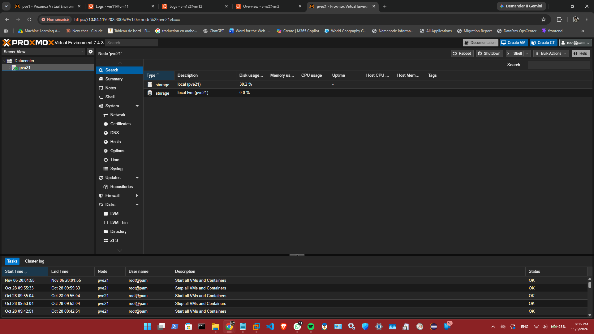

<em>Figure 20 : Nœud pve21 dans Proxmox</em>

**Figure 21.** Connexion à `10.84.119.202:8006` en cours (message « Please wait »).

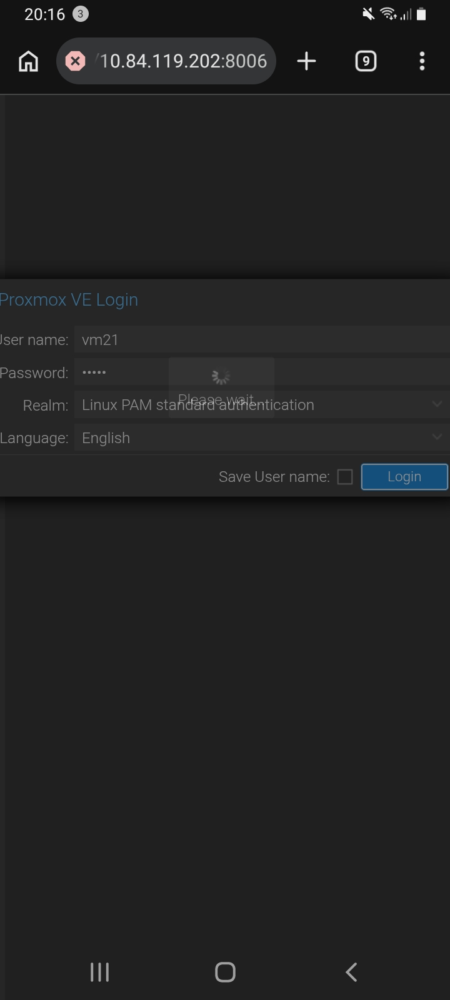

<em>Figure 21 : Connexion à pve21 depuis le téléphone</em>

**Figure 22.** Vue Datacenter après connexion en `root@pam` : le nœud pve21 et ses deux stockages sont visibles.

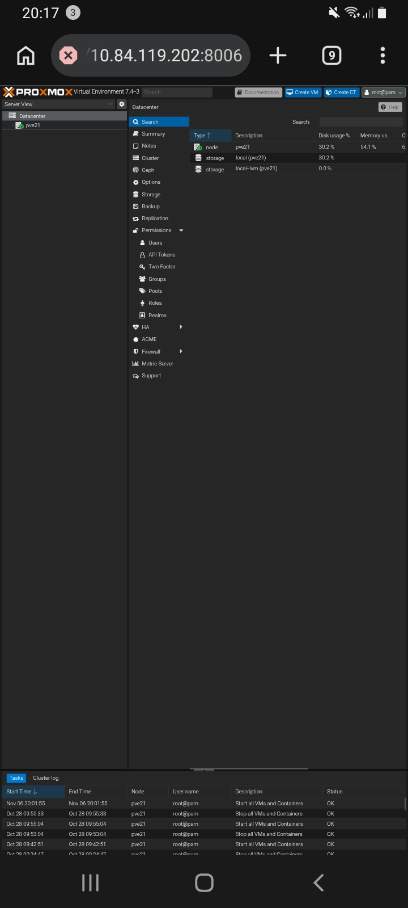

<em>Figure 22 : Datacenter pve21 depuis le téléphone</em>

**Figure 23.** Vue du nœud pve21 avec ses stockages et l'historique des tâches, depuis le téléphone.

<em>Figure 23 : Nœud pve21 depuis le téléphone</em>

## 8. VM22 : Proxmox pve22

**Figure 24.** pve22 : stockage `local` à 30,2 % et `local-lvm` à 0 %. Tâche *Start all VMs and Containers* du 6 novembre à 20:01:54, statut OK. L'état est identique à celui de pve21.

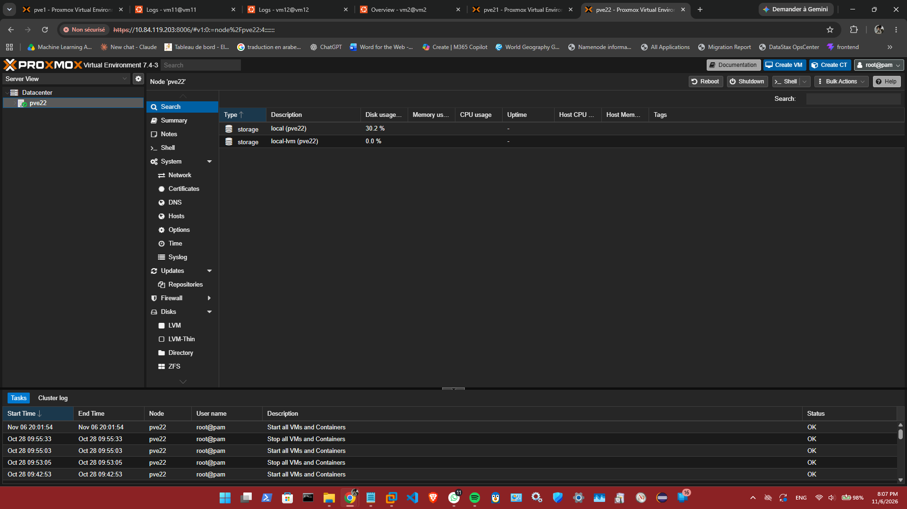

<em>Figure 24 : Nœud pve22 dans Proxmox</em>

**Figure 25.** Saisie de `root` sur `10.84.119.203:8006`, realm Linux PAM.

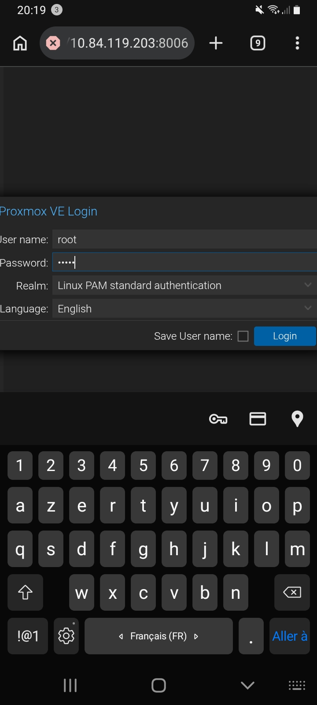

<em>Figure 25 : Connexion à pve22 depuis le téléphone</em>

**Figure 26.** Vue du nœud pve22 sur le téléphone, avec ses deux stockages et l'historique des tâches.

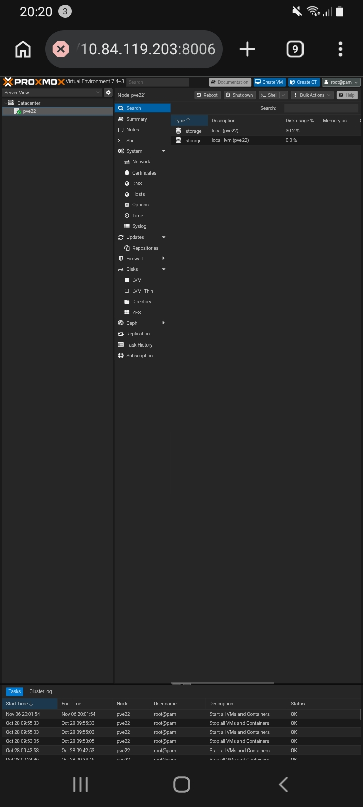

<em>Figure 26 : Nœud pve22 depuis le téléphone</em>

## 9. Observations

- **Stockage de pve1** : `local-lvm` est utilisé à 98,7 % (figure 3). C'est le point de vigilance principal : avec des disques en allocation dynamique, un pool plein provoque des erreurs d'écriture dans VM11 et VM12.
- **Avertissements TDX** : `TDX not supported by the host platform` est attendu, car l'hôte virtuel n'est pas une machine Intel TDX. Ce n'est pas une erreur.
- **Synchronisation NTP** : les délais dépassés de `chronyd` sur VM11 (figure 9) indiquent que NTS-KE (port 4460) n'a pas abouti pendant un moment. La cause probable est le réseau Wi-Fi du point d'accès (port filtré ou connexion instable au démarrage).
- **Mises à jour** : VM12 a des correctifs en attente (figures 12 et 15). Les autres machines Ubuntu sont à jour.
- **Cockpit en accès limité** : toutes les sessions Cockpit sont en mode limité. Il faut activer l'accès administrateur pour modifier le système.
- **Pics de CPU** : les valeurs proches de 95 % dans Proxmox (figure 3) viennent du démarrage des machines, pas d'une charge permanente.

## 10. Conclusion

Les 26 captures confirment que les six machines de l'architecture sont démarrées, qu'elles disposent d'une adresse IP sur le réseau 10.84.119.0/24 et qu'elles sont accessibles depuis le PC et depuis le téléphone, sur les ports 8006 (Proxmox) et 9090 (Cockpit). La virtualisation imbriquée fonctionne sur deux niveaux, avec VMware Workstation, Proxmox VE et KVM.
